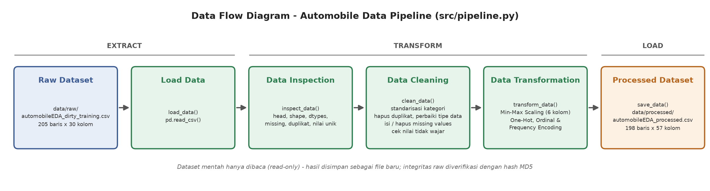

# Data Preparation & Pipeline Project — Automobile Dataset

Pipeline ETL sederhana berbasis **Python, Pandas, dan NumPy** yang mengubah dataset otomotif mentah
(`automobileEDA_dirty_training.csv`) menjadi *processed dataset* yang bersih dan siap dipakai untuk
analisis atau pemodelan (misalnya prediksi harga mobil).

```
Raw CSV → Load Data → Data Inspection → Data Cleaning → Data Transformation → Processed CSV
```

---

## 1. Dataset

| | |
|---|---|
| **Deskripsi** | Spesifikasi teknis dan harga 200-an mobil (merek, tipe bodi, mesin, dimensi, konsumsi BBM, harga). Setiap baris = satu mobil dengan tanggal transaksi. |
| **Sumber** | *Automobile Data Set* — UCI Machine Learning Repository (Ward's 1985 Automotive Yearbook), versi hasil EDA (`automobileEDA.csv`) yang sengaja "dikotori" untuk latihan. Diberikan mentor ReWork AI Engineering Bootcamp melalui `Dataset_Sesi_3.zip`. |
| **Input pipeline** | `data/raw/automobileEDA_dirty_training.csv` (205 baris × 30 kolom) |
| **Output pipeline** | `data/processed/automobileEDA_processed.csv` (198 baris × 57 kolom) |

Kolom utama: `transaction_date`, `make`, `body-style`, `drive-wheels`, `fuel-system`, `engine-size`,
`horsepower`, `curb-weight`, `city-mpg`, `highway-mpg`, `price` (target), dll.

> File `automobileEDA.csv` dan `automobile_processed.csv` dari mentor **hanya dipakai sebagai referensi**
> dan tidak disertakan/dipakai oleh pipeline. Processed dataset di repo ini 100% dihasilkan oleh `src/pipeline.py`.

## 2. Struktur Folder

```
data-pipeline-assignment/
├── data/
│   ├── raw/
│   │   └── automobileEDA_dirty_training.csv   # dataset mentah (read-only, tidak pernah ditimpa)
│   └── processed/
│       └── automobileEDA_processed.csv        # hasil pipeline (dibuat otomatis)
├── src/
│   └── pipeline.py                            # pipeline ETL
├── documentation/
│   ├── data-flow-diagram.png                  # diagram alur data
│   └── make_diagram.py                        # script pembuat diagram (opsional)
├── README.md
└── requirements.txt
```

## 3. Cara Menjalankan

**Prasyarat:** Python 3.10+ (diuji dengan Python 3.13, pandas 2.2.3 dan 3.1.1 — output identik).

```bash
# 1. (opsional) buat virtual environment
python -m venv .venv
# Windows
.venv\Scripts\activate
# macOS / Linux
source .venv/bin/activate

# 2. instal dependency
pip install -r requirements.txt

# 3. jalankan pipeline dari root project
python src/pipeline.py
```

Satu kali eksekusi menjalankan seluruh tahap (load → inspeksi → cleaning → transformasi → simpan) dan
mencetak hasil tiap tahap di terminal. Di akhir, script memverifikasi bahwa file mentah **tidak berubah**
dengan membandingkan hash MD5 sebelum dan sesudah pipeline berjalan.

Diagram dapat dibuat ulang (opsional) dengan `python documentation/make_diagram.py`.

## 4. Alur ETL



| Tahap | Function di `pipeline.py` | Proses |
|---|---|---|
| **Extract** | `load_data()` | Membaca CSV dari `data/raw/` |
| **Transform** | `inspect_data()` | Memeriksa head, shape, nama kolom, tipe data, missing values, duplikat, nilai unik kategori, format tanggal |
| | `clean_data()` | Standarisasi kategori, hapus duplikat, perbaiki tipe data, tangani missing values, cek nilai tidak wajar |
| | `transform_data()` | Min-Max Scaling, One-Hot / Ordinal / Frequency Encoding |
| **Load** | `save_data()` | Menyimpan hasil ke `data/processed/automobileEDA_processed.csv` |
| Orkestrasi | `run_pipeline()` | Menjalankan semua function di atas secara berurutan |

## 5. Kondisi Awal Dataset (Hasil Inspeksi)

| Aspek | Temuan |
|---|---|
| **Ukuran awal** | 205 baris × 30 kolom (19 numerik, 11 teks) |
| **Missing values** | 17 sel di 7 kolom: `stroke` (4), `horsepower` (3), `price` (3), `transaction_date` (2), `make` (2), `num-of-doors` (2), `horsepower-binned` (1) |
| **Duplikat** | 4 baris identik di semua kolom (baris 201–204 adalah salinan baris 5, 25, 60, 100) |
| **Tipe data belum sesuai** | `transaction_date` masih string; `num-of-doors` (`two`, `four`) dan `num-of-cylinders` (`two` … `twelve`) berisi angka yang ditulis sebagai kata |
| **Kategori tidak konsisten** | `make`: `ALFA-ROMERO`, `Audi`, `BMW`, `dodge␣␣`, `mercury␣␣`, `porsche␣␣` (huruf kapital & spasi di akhir) · `body-style`: `SEDAN`, `Sedan` · `drive-wheels`: `RWD`, `AWD` · `fuel-system`: `MPFI`, `Mpfi` |
| **Format tanggal campur** | 4 format berbeda di `transaction_date`: `2025-01-01` (YYYY-MM-DD, 51), `02/01/2025` (DD/MM/YYYY, 52), `01-03-2025` (MM-DD-YYYY, 50), `04-Jan-2025` (DD-Mon-YYYY, 50) |
| **Skala numerik tidak seragam** | Rentang sangat berbeda: `curb-weight` 1488–4066, `peak-rpm` 4150–6600, `engine-size` 61–326, `bore` 2.5–3.9; sementara `length` & `width` sudah dalam skala 0–1 |
| **Kategorikal berbentuk teks** | `make`, `aspiration`, `body-style`, `drive-wheels`, `engine-location`, `engine-type`, `fuel-system`, `horsepower-binned` belum bisa langsung dipakai model |
| **Lain-lain** | Kategori `AWD` hanya muncul 1×, padahal taksonomi dataset hanya `fwd`/`rwd`/`4wd`. `stroke` kosong pada 4 mobil Mazda bermesin *rotary* (mesin Wankel tidak punya langkah piston konvensional). Jaguar 262 hp tidak punya `horsepower-binned` karena di luar rentang bin. Outlier IQR ditemukan di beberapa kolom (mis. `price`, `compression-ratio`) |

## 6. Data Cleaning

Urutan cleaning dan alasannya:

| # | Masalah | Kolom | Metode | Alasan |
|---|---|---|---|---|
| 1 | Penulisan kategori tidak konsisten & spasi berlebih | `make`, `body-style`, `drive-wheels`, `fuel-system` (+ semua kolom kategori) | `str.strip()` + `str.lower()`; `horsepower-binned` → Title Case | `BMW` dan `bmw` adalah kategori yang sama; tanpa ini, encoding akan menghasilkan kolom ganda. |
| 2 | Sinonim kategori | `drive-wheels` | `awd` → `4wd` | AWD = penggerak semua roda, ekuivalen dengan `4wd` di taksonomi dataset; kategori dengan 1 data hanya akan menambah kolom one-hot yang hampir selalu 0. |
| 3 | Baris duplikat | semua | `drop_duplicates(keep="first")` | Dilakukan **setelah** standarisasi teks agar duplikat yang hanya beda huruf ikut terdeteksi. Duplikat membuat data bias ke baris tertentu. → **4 baris dihapus**. |
| 4 | Tipe tanggal salah & format campur | `transaction_date` | Parsing per pola regex dengan format eksplisit → `datetime64` | `pd.to_datetime` otomatis bisa salah membaca `02/01` vs `01-03` (hari/bulan tertukar). Hasil parsing tervalidasi: tanggal berurutan harian sesuai urutan baris. |
| 5 | Angka berbentuk kata | `num-of-doors`, `num-of-cylinders` | Mapping `two→2`, `four→4`, … → integer | Nilainya memang kuantitas berurutan, sehingga lebih informatif sebagai angka daripada teks. |
| 6 | Missing target | `price` (3) | **Hapus baris** | `price` adalah variabel target; mengisi target dengan nilai tebakan sama saja membuat label palsu untuk model. |
| 7 | Missing tanggal | `transaction_date` (2) | **Interpolasi** dari tanggal baris sebelum/sesudah | Tanggal tercatat harian & berurutan, sehingga nilai yang hilang dapat direkonstruksi dengan pasti (mis. 2025-02-09 ⟶ ? ⟶ 2025-02-11 menjadi 2025-02-10). |
| 8 | Missing merek | `make` (1 setelah dedup) | Lookup baris lain dengan spesifikasi teknis identik; jika tidak ada → `"unknown"` | Merek tidak bisa ditebak dengan mean/modus. Tidak ada baris dengan spesifikasi identik, sehingga diisi `unknown` dan **baris dipertahankan** karena fitur lainnya valid. |
| 9 | Missing jumlah pintu | `num-of-doors` (2) | **Modus per `body-style`** | Jumlah pintu sangat bergantung pada tipe bodi (sedan mayoritas 4 pintu, hatchback 2 pintu); lebih akurat daripada modus global. |
| 10 | Missing horsepower | `horsepower` (3) | **Median per `horsepower-binned`** | Kategori bin (Low/Medium/High) masih tersedia, sehingga nilai isian tetap konsisten dengan bin-nya. Median dipilih karena tahan terhadap outlier. |
| 11 | Missing bin horsepower | `horsepower-binned` (1) | Diturunkan dari `horsepower` memakai rentang bin di data (Low ≤ 101, Medium ≤ 155, High > 155) | Nilai horsepower diketahui (262 hp), jadi bin dapat dihitung secara deterministik → `High`. |
| 12 | Missing stroke | `stroke` (4) | **Median keseluruhan** (3.29) | Mesin rotary tidak punya stroke, tetapi model butuh nilai numerik. Median tidak terpengaruh outlier (`stroke` punya 23 outlier IQR). |
| 13 | Nilai tidak wajar | numerik | Validasi aturan domain + deteksi outlier IQR | Tidak ditemukan nilai mustahil (tidak ada nilai negatif, `symboling` dalam −3..3, `diesel + gas = 1`, `city-L/100km = 235/city-mpg`). Outlier IQR **dipertahankan** karena masuk akal (mobil mewah, mesin diesel dengan compression ratio tinggi). |

### Hasil cleaning

| Metrik | Sebelum | Sesudah |
|---|---|---|
| Jumlah baris | 205 | **198** (−4 duplikat, −3 tanpa `price`) |
| Jumlah kolom | 30 | 30 |
| Total missing values | 17 | **0** |
| Baris duplikat | 4 | 0 |

Kolom yang berubah (dicetak juga oleh pipeline): `transaction_date` (string → datetime, 150 sel berubah format),
`num-of-doors` & `num-of-cylinders` (teks → integer), `make` (7 sel), `body-style` (2), `drive-wheels` (2),
`fuel-system` (2), `stroke` (4), `horsepower` (3), `horsepower-binned` (1).

## 7. Data Transformation

| Kolom | Metode | Alasan pemilihan | Kolom yang dihasilkan |
|---|---|---|---|
| `curb-weight`, `engine-size`, `horsepower`, `peak-rpm`, `city-mpg`, `highway-mpg` | **Min-Max Scaling** `x' = (x − min) / (max − min)` | Fitur kontinu dengan rentang paling berbeda jauh (13 s/d 6600). Disamakan ke [0, 1] agar tidak ada fitur yang mendominasi algoritma berbasis jarak/gradien. `length`/`width` tidak di-scale karena sudah 0–1; `price` tidak di-scale karena target (harus tetap dalam satuan harga). | `<kolom>_minmax` (6 kolom baru, kolom asli **dipertahankan** agar bisa dibandingkan) |
| `aspiration`, `body-style`, `drive-wheels`, `engine-location`, `engine-type`, `fuel-system` | **One-Hot Encoding** | Kategori nominal (tidak berurutan) dengan kardinalitas rendah (2–8 nilai). Label encoding akan memberi urutan palsu. | 26 kolom dummy 0/1, mis. `body-style_sedan`; kolom teks asli diganti |
| `horsepower-binned` | **Ordinal Encoding** (Low=0, Medium=1, High=2) | Kategori memiliki urutan alami. | `horsepower-binned_ordinal` (menggantikan kolom teks) |
| `make` | **Frequency Encoding** (proporsi kemunculan) | 23 kategori merek (22 merek + `unknown`) → one-hot akan menambah 23 kolom jarang. Frekuensi tetap menangkap informasi popularitas merek dalam 1 kolom. | `make_freq`; kolom `make` dipertahankan sebagai label untuk analisis |

### Contoh nilai sebelum dan sesudah transformasi

**Min-Max Scaling** (5 baris pertama processed dataset)

| curb-weight | curb-weight_minmax | engine-size | engine-size_minmax | horsepower | horsepower_minmax | city-mpg | city-mpg_minmax |
|---:|---:|---:|---:|---:|---:|---:|---:|
| 2548 | 0.4112 | 130 | 0.2604 | 111 | 0.2944 | 21 | 0.2222 |
| 2548 | 0.4112 | 130 | 0.2604 | 111 | 0.2944 | 21 | 0.2222 |
| 2823 | 0.5178 | 152 | 0.3434 | 154 | 0.4953 | 19 | 0.1667 |
| 2337 | 0.3293 | 109 | 0.1811 | 102 | 0.2523 | 24 | 0.3056 |
| 2824 | 0.5182 | 136 | 0.2830 | 115 | 0.3131 | 18 | 0.1389 |

Parameter scaling: `curb-weight` 1488–4066, `engine-size` 61–326, `horsepower` 48–262,
`peak-rpm` 4150–6600, `city-mpg` 13–49, `highway-mpg` 16–54.

**One-Hot Encoding** (`body-style`)

| body-style (sebelum) | body-style_convertible | body-style_hardtop | body-style_hatchback | body-style_sedan | body-style_wagon |
|---|---:|---:|---:|---:|---:|
| convertible | 1 | 0 | 0 | 0 | 0 |
| hatchback | 0 | 0 | 1 | 0 | 0 |
| sedan | 0 | 0 | 0 | 1 | 0 |

**Ordinal & Frequency Encoding**

| horsepower-binned | → `horsepower-binned_ordinal` | | make | → `make_freq` |
|---|---:|---|---|---:|
| Low | 0 | | toyota | 0.1667 (33/198) |
| Medium | 1 | | mazda | 0.0859 (17/198) |
| High | 2 | | alfa-romero | 0.0152 (3/198) |

## 8. Hasil Akhir

| | Raw | Processed |
|---|---|---|
| Baris | 205 | **198** |
| Kolom | 30 | **57** |
| Missing values | 17 | **0** |
| Duplikat | 4 | **0** |
| Kolom teks | 11 | 1 (`make`, label; versi numeriknya `make_freq`) |

**Lokasi processed dataset:** [`data/processed/automobileEDA_processed.csv`](data/processed/automobileEDA_processed.csv)

Susunan kolom: `transaction_date`, `make`, `make_freq` → fitur numerik hasil cleaning (termasuk `price`) →
6 kolom `_minmax` → `horsepower-binned_ordinal` → 26 kolom one-hot.

Dataset mentah di `data/raw/` tetap utuh (MD5 `92b4a3cdf229197d356f4fc422ab3720`, diverifikasi otomatis setiap pipeline dijalankan).

---

## Author

**Juwiharso Dermawan** ([@juwihars0508](https://github.com/juwihars0508))
Individual Assignment — Data Engineering: Pipeline & Preparation · AI Engineering Bootcamp ReWork
